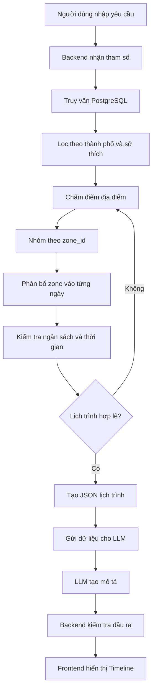

# Phân tích đề tài GeoZone AI – Phần 2, 3, 4

Tài liệu này tổng hợp đầy đủ phần phân tích về **Đặt vấn đề (Problem Statement)**, **Mục tiêu dự án (Project Objectives)** và **Giải pháp – Cách tiếp cận (Proposed Approach)**, cùng các điểm cần điều chỉnh, ví dụ minh họa và kết luận.

---

# Định hướng tổng quát

Mình sẽ phân tích ba phần 2, 3, 4 theo hướng giải thích bản chất bài toán, cách hệ thống thực sự hoạt động, thuật toán cần triển khai và mối liên hệ giữa các thành phần. Đồng thời, cần chỉ ra những chỗ trong đề xuất hiện tại chưa chính xác hoặc còn thiếu logic.

Trước tiên, cần hiểu một ý quan trọng:

**GeoZone AI không phải là dự án xây dựng một AI tự tìm địa điểm và tự tính đường đi.** Đây là hệ thống lập lịch trình dựa trên dữ liệu có cấu trúc và thuật toán Backend, trong đó LLM chủ yếu đảm nhận việc diễn đạt, giải thích và trình bày kết quả.

Có thể hình dung luồng tổng quát:

```text
Người dùng nhập yêu cầu
(Ngân sách · Số ngày · Sở thích · Thời gian)
                 |
                 v
Backend truy vấn dữ liệu địa điểm
(Lọc theo sở thích, giá tiền, zone_id)
                 |
                 v
Thuật toán lập lịch trình
(Chọn địa điểm · Phân bổ ngân sách · Sắp xếp theo ngày và khu vực)
                 |
                 v
LLM xử lý ngôn ngữ
(Diễn đạt lịch trình thành nội dung dễ đọc)
                 |
                 v
Frontend hiển thị Timeline
(Xem, thay thế và điều chỉnh địa điểm)
```

---

# 2. Đặt vấn đề (Problem Statement)

Đây là phần trả lời câu hỏi: **Tại sao cần xây dựng GeoZone AI? Bài toán thực tế mà dự án muốn giải quyết là gì?**

## 2.1. Vấn đề thứ nhất: Lập lịch trình du lịch thủ công rất phức tạp

Giả sử một người muốn đi du lịch Đà Nẵng trong 3 ngày với các yêu cầu:

- Ngân sách: 3.000.000 VNĐ.
- Thời gian: 3 ngày.
- Sở thích: ẩm thực, biển, văn hóa.
- Muốn mỗi ngày có khoảng 3–4 địa điểm.
- Không muốn di chuyển quá nhiều giữa các khu vực.

Để tạo được một lịch trình hợp lý, người đó phải tự giải quyết nhiều vấn đề.

### Vấn đề A – Tìm địa điểm phù hợp

Phải tìm những địa điểm đáp ứng sở thích. Ví dụ:

| Địa điểm | Loại hình | Chi phí dự kiến |
|---|---|---:|
| Bãi biển Mỹ Khê | Biển | 0đ |
| Bảo tàng Chăm | Văn hóa | 60.000đ |
| Bà Nà Hills | Vui chơi | 900.000đ |
| Chợ Cồn | Ẩm thực | 100.000đ |
| Ngũ Hành Sơn | Tham quan | 40.000đ |

### Vấn đề B – Phân bổ ngân sách

Nếu chọn tất cả địa điểm, tổng chi phí là:

\[
C = \sum_{i=1}^{n} cost_i
\]

Nhưng tổng chi phí chưa chắc đã phù hợp với ngân sách.

Ngoài ra, một ngày có thể cần giới hạn chi tiêu riêng để tránh trường hợp ngày đầu tiêu hết phần lớn ngân sách.

### Vấn đề C – Sắp xếp thứ tự địa điểm

Giả sử người dùng muốn đến:

- Bảo tàng Chăm.
- Chợ Cồn.
- Bãi biển Mỹ Khê.
- Ngũ Hành Sơn.

Nếu sắp xếp tùy ý, người dùng có thể phải di chuyển qua lại giữa các khu vực, gây mất thời gian và chi phí.

### Vấn đề D – Phân bổ thời gian

Một địa điểm có thể cần 30 phút, trong khi địa điểm khác cần 3 tiếng.

Nếu chỉ chọn địa điểm mà không xét thời lượng trải nghiệm thì lịch trình có thể không thực hiện được trong thực tế.

Như vậy, bài toán không đơn giản là tìm những địa điểm du lịch tốt, mà là:

> Chọn một tập hợp địa điểm phù hợp với sở thích, ngân sách và thời gian, sau đó sắp xếp chúng thành một lịch trình có thể thực hiện được.

## 2.2. Vấn đề thứ hai: Hallucination của LLM

Đây là lý do dự án muốn kết hợp thuật toán truyền thống với LLM.

Giả sử người dùng hỏi một LLM:

"Hãy lập lịch trình du lịch Đà Nẵng 3 ngày với ngân sách 3 triệu."

LLM có thể trả về:

- Một địa điểm không tồn tại.
- Một địa điểm có tồn tại nhưng đã đóng cửa.
- Giá vé không chính xác.
- Khoảng cách giữa hai địa điểm không đúng.
- Một lịch trình có tổng chi phí vượt quá ngân sách.

Tại sao lại xảy ra hiện tượng này?

Bởi vì LLM về bản chất là mô hình dự đoán token tiếp theo dựa trên dữ liệu đã học và ngữ cảnh đầu vào.

LLM không mặc định có khả năng:

- Truy cập dữ liệu địa điểm cập nhật theo thời gian thực.
- Biết chính xác giá vé hiện tại.
- Tính toán khoảng cách địa lý chính xác.
- Đảm bảo các phép tính ngân sách luôn đúng.

Ví dụ, nếu yêu cầu LLM tạo lịch trình có tổng chi phí không quá 3 triệu, nó có thể viết ra một lịch trình trông rất hợp lý nhưng khi cộng các khoản chi phí lại thì lên đến 3,5 triệu.

Đây chính là vấn đề GeoZone muốn giải quyết.

## 2.3. Vấn đề thứ ba: Tại sao không sử dụng thuật toán định tuyến truyền thống?

Một cách tiếp cận khác là sử dụng thuật toán đồ thị.

Giả sử có 100 địa điểm du lịch. Ta có thể biểu diễn:

- Mỗi địa điểm là một đỉnh.
- Mỗi tuyến đường giữa hai địa điểm là một cạnh.
- Trọng số cạnh là khoảng cách hoặc thời gian di chuyển.

Khi đó, bài toán sắp xếp địa điểm có thể được mô hình hóa thành bài toán TSP (Traveling Salesman Problem).

Mục tiêu:

\[
\min \sum_{i=1}^{n} d(v_i,v_{i+1})
\]

Trong đó \(d(v_i,v_j)\) là khoảng cách giữa hai địa điểm.

Tuy nhiên, TSP có độ phức tạp tính toán rất lớn khi số lượng địa điểm tăng. TSP tổng quát là bài toán NP-hard.

Nhưng cần hiểu đúng: **TSP không phải lúc nào cũng cần thiết và cũng không phải cứ 100–150 địa điểm là không thể giải được.** Có nhiều thuật toán heuristic và approximation giúp giải các trường hợp quy mô vừa.

GeoZone chọn cách tiếp cận đơn giản hơn: không tối ưu chính xác khoảng cách giữa từng cặp địa điểm, mà sử dụng phân vùng địa lý để giảm độ phức tạp của việc sắp xếp.

## 2.4. Tóm lại, bài toán cần giải quyết là gì?

Có thể chia thành ba vấn đề chính:

| Vấn đề | Giải pháp của GeoZone |
|---|---|
| Khó tìm địa điểm phù hợp | Lọc dữ liệu dựa trên tags |
| Khó kiểm soát chi phí và thời gian | Thuật toán Backend tính toán |
| Khó sắp xếp lịch trình hợp lý | Gom nhóm địa điểm theo zone_id |
| LLM có thể bịa dữ liệu | Chỉ cho LLM sử dụng dữ liệu Backend đã chọn |

Lưu ý: GeoZone không loại bỏ hoàn toàn hallucination và không đảm bảo độ chính xác tuyệt đối. Nó chỉ giảm đáng kể khả năng LLM tự tạo ra dữ liệu sai bằng cách tách phần tính toán và kiểm soát dữ liệu ra khỏi LLM.

---

# 3. Mục tiêu dự án (Project Objectives)

Phần này trả lời câu hỏi: **Sau khi xây dựng xong, hệ thống phải làm được những gì?**

Trong đề tài GeoZone, nên chia mục tiêu thành 4 mục tiêu nhỏ thay vì chỉ nói chung chung là xây dựng ứng dụng lập lịch trình du lịch.

## 3.1. Mục tiêu 1: Cá nhân hóa lịch trình theo nhu cầu người dùng

Hệ thống phải tiếp nhận các thông tin đầu vào và sử dụng chúng để quyết định những địa điểm nào nên xuất hiện trong lịch trình.

Ví dụ người dùng nhập:

**Thông tin chuyến du lịch**

- Điểm đến: Đà Nẵng.
- Số ngày: 3 ngày.
- Ngân sách: 3.000.000 VNĐ.
- Sở thích: ẩm thực, biển, văn hóa.

Yêu cầu bổ sung: ưu tiên địa điểm có chi phí thấp, không muốn di chuyển quá nhiều.

Hệ thống cần chuyển những thông tin này thành các điều kiện có thể xử lý bằng chương trình.

Ví dụ:

```json
{
  "city": "Da Nang",
  "duration": 3,
  "budget": 3000000,
  "preferences": [
    "food",
    "beach",
    "culture"
  ],
  "priority": "low_cost"
}
```

Đây là điểm quan trọng: người dùng nhập dữ liệu dưới dạng biểu mẫu, nhưng Backend phải chuyển nó thành những điều kiện lọc cụ thể.

Ví dụ:

- `food`: chỉ ưu tiên địa điểm có tag ẩm thực.
- `beach`: ưu tiên địa điểm có tag biển.
- `culture`: ưu tiên địa điểm có tag văn hóa.
- `low_cost`: ưu tiên những địa điểm có chi phí thấp.

Như vậy, mục tiêu đầu tiên là biến sở thích của người dùng thành các tiêu chí lựa chọn địa điểm.

## 3.2. Mục tiêu 2: Tự động xây dựng lịch trình thỏa mãn các ràng buộc

Đây mới là phần quan trọng nhất về mặt thuật toán.

Hệ thống không chỉ tìm địa điểm mà còn phải chọn địa điểm sao cho lịch trình thỏa mãn những điều kiện nhất định.

Có thể mô hình hóa thành bài toán tối ưu hóa.

Giả sử:

- \(P\): tập hợp các địa điểm du lịch.
- \(D\): số ngày du lịch.
- \(B\): ngân sách tối đa.
- \(c_i\): chi phí tại địa điểm \(i\).
- \(t_i\): thời gian trải nghiệm tại địa điểm \(i\).
- \(x_i\): biến quyết định có chọn địa điểm \(i\) hay không.

Ta có:

\[
x_i =
\begin{cases}
1 & \text{nếu chọn địa điểm }i\\
0 & \text{nếu không chọn địa điểm }i
\end{cases}
\]

### Ràng buộc 1 – Ngân sách

\[
\sum_{i=1}^{n} c_i x_i \leq B
\]

Có nghĩa là tổng chi phí của những địa điểm được chọn không vượt quá ngân sách.

### Ràng buộc 2 – Thời gian

Giả sử mỗi ngày có tối đa \(T\) giờ dành cho tham quan.

\[
\sum_{i \in P_d} t_i \leq T
\]

Trong đó \(P_d\) là tập địa điểm được xếp vào ngày \(d\).

Thực tế nên cộng thêm thời gian di chuyển và nghỉ ngơi:

\[
\sum_{i \in P_d} t_i
+
\sum_{(i,j)\in P_d} travelTime(i,j)
\leq T
\]

### Ràng buộc 3 – Sở thích

Địa điểm được chọn cần có mức độ phù hợp với sở thích của người dùng.

Ta có thể gán điểm phù hợp \(s_i\) cho mỗi địa điểm.

Ví dụ:

| Địa điểm | Sở thích phù hợp | Điểm |
|---|---|---:|
| Bãi biển Mỹ Khê | Biển | 1.0 |
| Bảo tàng Chăm | Văn hóa | 1.0 |
| Chợ Cồn | Ẩm thực | 1.0 |
| Bà Nà Hills | Vui chơi | 0.2 |

Điểm càng cao thì địa điểm càng phù hợp.

### Mục tiêu tối ưu

Có thể sử dụng hàm mục tiêu:

\[
\max \sum_{i=1}^{n}s_i x_i
\]

Tức là lựa chọn tập hợp địa điểm có tổng điểm phù hợp cao nhất, đồng thời thỏa mãn ngân sách và thời gian.

Tuy nhiên, đây mới là mô hình hóa tổng quát. Để làm dự án, nhóm không nhất thiết phải triển khai một thuật toán tối ưu hóa phức tạp.

Có thể sử dụng thuật toán tham lam (Greedy) để chọn địa điểm theo thứ tự ưu tiên, kiểm tra ngân sách và thời gian sau mỗi lần chọn.

Ví dụ:

1. Lọc những địa điểm phù hợp với sở thích.
2. Sắp xếp theo điểm phù hợp.
3. Chọn địa điểm có điểm phù hợp cao.
4. Kiểm tra ngân sách còn lại.
5. Kiểm tra thời gian còn lại.
6. Nếu thỏa mãn thì thêm vào lịch trình, nếu không thì bỏ qua.

Đây là một phương án thực tế, dễ triển khai và phù hợp với quy mô dự án học thuật.

## 3.3. Mục tiêu 3: Đảm bảo tính hợp lý về mặt địa lý

Đây chính là mục tiêu tạo nên điểm khác biệt của GeoZone.

Thay vì lựa chọn địa điểm một cách độc lập, hệ thống sẽ ưu tiên những địa điểm nằm gần nhau về mặt khu vực.

Ví dụ, giả sử nhóm chia Đà Nẵng thành các khu vực:

| Zone | Khu vực | Địa điểm ví dụ |
|---|---|---|
| Z1 | Trung tâm thành phố | Chợ Cồn, Bảo tàng Chăm |
| Z2 | Khu vực ven biển | Mỹ Khê, Công viên Biển Đông |
| Z3 | Sơn Trà | Chùa Linh Ứng, Bãi Bụt |
| Z4 | Ngũ Hành Sơn | Ngũ Hành Sơn, Non Nước |
| Z5 | Ngoại thành | Bà Nà Hills |

Giả sử hệ thống lựa chọn được 6 địa điểm.

Thay vì xếp chúng ngẫu nhiên:

- Ngày 1: Z1 → Z3 → Z1.
- Ngày 2: Z2 → Z4 → Z2.
- Ngày 3: Z5 → Z1.

Hệ thống sẽ ưu tiên gom các địa điểm cùng khu vực vào một ngày.

Ví dụ:

- Ngày 1: Z1.
- Ngày 2: Z2 và Z3.
- Ngày 3: Z4 và Z5.

Đây là tư duy phân cụm theo vùng địa lý.

Tuy nhiên, có một điểm cần phân biệt:

**Cùng zone không đồng nghĩa với hai địa điểm chắc chắn gần nhau hoặc có thể đi bộ giữa chúng.**

Zone chỉ là một cách xấp xỉ không gian để giảm việc di chuyển qua lại giữa các khu vực.

Do đó, mục tiêu của GeoZone là giảm sự phân tán địa lý của lịch trình, chứ chưa phải tìm ra tuyến đường ngắn nhất.

## 3.4. Mục tiêu 4: Sử dụng LLM để cải thiện trải nghiệm người dùng

Sau khi Backend đã lựa chọn địa điểm và xây dựng lịch trình, dữ liệu thường ở dạng JSON khá khô khan.

Ví dụ:

```json
{
  "day": 1,
  "zone": "Z1",
  "places": [
    {
      "name": "Cho Con",
      "cost": 100000,
      "duration": 90
    },
    {
      "name": "Bao tang Cham",
      "cost": 60000,
      "duration": 120
    }
  ]
}
```

LLM có nhiệm vụ chuyển dữ liệu đó thành nội dung dễ đọc:

> **Ngày 1 – Khám phá trung tâm Đà Nẵng**
>
> Buổi sáng, bạn có thể bắt đầu tại Bảo tàng Điêu khắc Chăm để tìm hiểu về văn hóa và lịch sử Champa.
>
> Buổi trưa, hãy ghé thăm Chợ Cồn để trải nghiệm các món ăn đặc sản địa phương.

Điều quan trọng là LLM không được tự ý thêm địa điểm, thay đổi giá tiền hoặc thay đổi thời gian đã được Backend tính toán.

Có thể hình dung:

| Thành phần | Trách nhiệm |
|---|---|
| Backend | Chọn địa điểm |
| Backend | Tính ngân sách |
| Backend | Phân bổ ngày |
| Backend | Sắp xếp khu vực |
| LLM | Viết lời giới thiệu |
| LLM | Tạo nội dung dễ đọc |
| Frontend | Hiển thị lịch trình |

**Tóm lại mục tiêu dự án:**

GeoZone cần tạo được một lịch trình du lịch thỏa mãn ba điều kiện chính: phù hợp sở thích, không vượt ngân sách và có sự hợp lý về mặt địa lý. LLM giúp biến kết quả tính toán thành một trải nghiệm tương tác tự nhiên.

---

# 4. Giải pháp và cách tiếp cận (Proposed Approach)

Đây là phần quan trọng nhất của đề tài vì nó trả lời câu hỏi:

**Cụ thể nhóm sẽ giải quyết bài toán bằng phương pháp nào? Thuật toán nào được sử dụng? Dữ liệu đi qua hệ thống ra sao?**

Có ba thành phần chính trong đề xuất: Zone-based Data, Logic phân cụm và Kiểm soát AI.

## 4.1. Zone-based Data – Xây dựng dữ liệu địa điểm theo phân vùng

Trước hết, nhóm cần xây dựng một cơ sở dữ liệu các địa điểm du lịch.

Ví dụ, nhóm lựa chọn Đà Nẵng làm thành phố thử nghiệm và thu thập 100–150 địa điểm.

Mỗi địa điểm không chỉ lưu tên mà còn phải lưu các thông tin cần thiết để thuật toán có thể xử lý.

### A. Thiết kế dữ liệu cho một địa điểm

Ví dụ một bản ghi:

```json
{
  "id": 1,
  "name": "Bai bien My Khe",
  "city": "Da Nang",
  "zone_id": 2,
  "category": "Beach",
  "tags": [
    "beach",
    "swimming",
    "sightseeing"
  ],
  "estimated_cost": 0,
  "duration": 120,
  "opening_time": "05:00",
  "closing_time": "18:00",
  "latitude": 16.0544,
  "longitude": 108.2477
}
```

Giải thích từng trường:

| Trường | Ý nghĩa | Tác dụng |
|---|---|---|
| `id` | ID địa điểm | Định danh |
| `name` | Tên địa điểm | Hiển thị |
| `city` | Thành phố | Lọc theo thành phố |
| `zone_id` | Mã khu vực | Gom nhóm |
| `category` | Loại địa điểm | Phân loại |
| `tags` | Các nhãn đặc trưng | Lọc sở thích |
| `estimated_cost` | Chi phí ước tính | Tính ngân sách |
| `duration` | Thời gian trải nghiệm | Tính lịch trình |
| `opening_time` | Giờ mở cửa | Kiểm tra thời gian |
| `closing_time` | Giờ đóng cửa | Kiểm tra thời gian |
| `latitude` | Vĩ độ | Có thể dùng để tính khoảng cách |
| `longitude` | Kinh độ | Có thể dùng để tính khoảng cách |

Có một điểm cần điều chỉnh trong đề xuất ban đầu: dù hệ thống sử dụng `zone_id`, vẫn nên lưu `latitude` và `longitude`.

Tại sao?

Bởi vì việc sử dụng zone-based không có nghĩa là không cần tọa độ.

Tọa độ có thể được dùng để:

- Kiểm tra xem hai địa điểm có thực sự nằm gần nhau không.
- Hỗ trợ hiển thị bản đồ.
- Sau này nâng cấp sang tính toán khoảng cách thực tế.
- Kiểm tra lại chất lượng của việc gán zone.

Ở phiên bản đầu tiên, nhóm có thể không sử dụng tọa độ trong thuật toán lập lịch, nhưng vẫn nên lưu chúng trong database.

### B. `zone_id` thực chất là gì?

Đây là khái niệm quan trọng nhất trong giải pháp.

Giả sử Đà Nẵng có 100 địa điểm.

Thay vì phải xem xét mối quan hệ giữa từng cặp địa điểm, nhóm chia chúng thành 5 khu vực.

Ví dụ:

| Địa điểm | zone_id |
|---|---|
| Chợ Cồn | Z1 |
| Bảo tàng Chăm | Z1 |
| Cầu Rồng | Z1 |
| Bãi biển Mỹ Khê | Z2 |
| Công viên Biển Đông | Z2 |
| Chùa Linh Ứng | Z3 |
| Bãi Bụt | Z3 |
| Ngũ Hành Sơn | Z4 |
| Làng đá Non Nước | Z4 |
| Bà Nà Hills | Z5 |

Như vậy, mỗi địa điểm được gắn một nhãn khu vực.

Đây chính là **phân cụm không gian dựa trên nhãn (zone-based grouping)**.

Lưu ý rằng ở đây không nhất thiết phải sử dụng thuật toán K-means hay DBSCAN. Nhóm có thể xác định khu vực bằng kiến thức địa lý và gán nhãn thủ công.

### C. Tại sao cách này giúp giảm độ phức tạp?

Giả sử có 100 địa điểm.

Nếu muốn tính khoảng cách giữa tất cả các cặp địa điểm, số cặp cần xét là:

\[
\frac{n(n-1)}{2}
\]

Với \(n=100\):

\[
\frac{100\times99}{2}=4950
\]

Nếu chỉ có 5 zone, hệ thống có thể thao tác trên 5 nhóm khu vực thay vì phải trực tiếp tối ưu thứ tự của cả 100 địa điểm.

Tuy nhiên, cần hiểu chính xác: 4.950 phép tính khoảng cách không phải là khối lượng quá lớn đối với máy tính thông thường. Lợi ích chủ yếu của zone-based là đơn giản hóa mô hình lập lịch và giảm số phương án phải cân nhắc, chứ không phải giải quyết một vấn đề hiệu năng không thể xử lý.

### D. Thiết kế database PostgreSQL

Nhóm có thể thiết kế ba bảng chính:

**Bảng `zones`**

| id | name | description |
|---|---|---|
| 1 | Center | Trung tâm |
| 2 | Beach | Khu vực biển |
| 3 | Son Tra | Bán đảo Sơn Trà |
| 4 | Marble Mountains | Ngũ Hành Sơn |

**Bảng `places`**

| id | name | zone_id | cost | duration |
|---|---|---:|---:|---:|
| 1 | Chợ Cồn | 1 | 100000 | 90 |
| 2 | Bảo tàng Chăm | 1 | 60000 | 120 |
| 3 | Mỹ Khê | 2 | 0 | 120 |
| 4 | Chùa Linh Ứng | 3 | 0 | 90 |

**Bảng `tags`**

| id | name |
|---|---|
| 1 | food |
| 2 | beach |
| 3 | culture |
| 4 | adventure |

Vì một địa điểm có thể có nhiều tag và một tag có thể thuộc nhiều địa điểm, nên cần bảng trung gian `place_tags`.

Quan hệ:

```text
zones
  |
  | 1 - N
  |
places
  |
  | N - N
  |
place_tags
  |
  | N - 1
  |
tags
```

Với Prisma ORM, nhóm có thể ánh xạ những quan hệ này thành các model tương ứng.

---

## 4.2. Logic phân cụm – Thuật toán xây dựng lịch trình

Đây là phần cốt lõi của Backend.

Có dữ liệu địa điểm rồi nhưng làm thế nào để chọn ra những địa điểm phù hợp và sắp xếp chúng thành lịch trình?

Lấy một ví dụ xuyên suốt để dễ hình dung.

### Bước 1: Nhận yêu cầu từ người dùng

Giả sử người dùng nhập:

```json
{
  "city": "Da Nang",
  "days": 2,
  "budget": 1000000,
  "preferences": [
    "food",
    "culture",
    "beach"
  ]
}
```

Backend nhận được:

- Đi du lịch Đà Nẵng.
- 2 ngày.
- Ngân sách 1 triệu.
- Thích ẩm thực, văn hóa và biển.

### Bước 2: Truy vấn các địa điểm phù hợp

Backend sử dụng các điều kiện lọc để truy vấn PostgreSQL.

Ví dụ:

```sql
SELECT DISTINCT p.*
FROM places p
JOIN place_tags pt ON p.id = pt.place_id
JOIN tags t ON pt.tag_id = t.id
WHERE p.city = 'Da Nang'
AND t.name IN ('food', 'culture', 'beach');
```

Câu lệnh này có ý nghĩa:

1. Lấy danh sách địa điểm.
2. Kết nối với bảng tag.
3. Chỉ lấy những địa điểm có ít nhất một tag phù hợp.
4. Loại bỏ bản ghi trùng lặp.

Kết quả có thể là:

| Địa điểm | Zone | Tag | Chi phí | Thời lượng |
|---|---|---|---:|---:|
| Chợ Cồn | Z1 | food | 100.000 | 90 phút |
| Bảo tàng Chăm | Z1 | culture | 60.000 | 120 phút |
| Cầu Rồng | Z1 | culture | 0 | 45 phút |
| Mỹ Khê | Z2 | beach | 0 | 120 phút |
| Công viên Biển Đông | Z2 | beach | 0 | 60 phút |
| Chùa Linh Ứng | Z3 | culture | 0 | 90 phút |
| Ngũ Hành Sơn | Z4 | culture | 40.000 | 120 phút |

Lúc này hệ thống chưa tạo lịch trình.

Nó mới chỉ có một danh sách các địa điểm thỏa mãn điều kiện sở thích.

### Bước 3: Chấm điểm và lựa chọn địa điểm

Đây là bước có thể phát triển thành thuật toán riêng của nhóm.

Không phải cứ một địa điểm phù hợp sở thích thì đều phải đưa vào lịch trình.

Ví dụ, ngân sách chỉ có 1 triệu, trong khi có rất nhiều địa điểm.

Ta cần lựa chọn những địa điểm nào được đưa vào.

Có thể thiết kế một hàm chấm điểm:

\[
Score(i)=w_1Preference(i)+w_2Popularity(i)+w_3Cost(i)
\]

Trong đó:

- `Preference`: Mức độ phù hợp với sở thích.
- `Popularity`: Mức độ phổ biến của địa điểm.
- `Cost`: Điểm ưu tiên về chi phí.
- \(w_1,w_2,w_3\): Trọng số do nhóm xác định.

Ví dụ:

| Địa điểm | Preference | Popularity | Cost score |
|---|---:|---:|---:|
| Chợ Cồn | 1.0 | 0.9 | 0.8 |
| Bảo tàng Chăm | 1.0 | 0.7 | 0.9 |
| Mỹ Khê | 1.0 | 1.0 | 1.0 |
| Ngũ Hành Sơn | 1.0 | 0.8 | 0.9 |

Sau đó tính điểm tổng hợp và sắp xếp giảm dần.

Lưu ý: nếu dự án không có dữ liệu đánh giá độ phổ biến thì không nên tự tạo `Popularity` tùy tiện. Nhóm có thể bắt đầu với hai tiêu chí sở thích và chi phí.

Một cách chấm điểm chi phí đơn giản:

\[
CostScore(i)=1-\frac{c_i}{C_{\max}}
\]

Trong đó \(C_{\max}\) là chi phí tham chiếu do nhóm xác định.

Địa điểm càng rẻ thì điểm chi phí càng cao.

### Bước 4: Phân nhóm theo zone_id

Sau khi có danh sách địa điểm phù hợp, hệ thống nhóm chúng theo `zone_id`.

Ví dụ kết quả phân nhóm:

- **Zone 1 – Trung tâm:** Chợ Cồn, Bảo tàng Chăm, Cầu Rồng.
- **Zone 2 – Ven biển:** Mỹ Khê, Công viên Biển Đông.
- **Zone 3 – Sơn Trà:** Chùa Linh Ứng.
- **Zone 4 – Ngũ Hành Sơn:** Ngũ Hành Sơn.

Về mặt lập trình, có thể sử dụng cấu trúc Map trong JavaScript:

```javascript
const groupedPlaces = new Map();

for (const place of places) {
    if (!groupedPlaces.has(place.zoneId)) {
        groupedPlaces.set(place.zoneId, []);
    }

    groupedPlaces.get(place.zoneId).push(place);
}
```

Kết quả là một tập hợp các nhóm địa điểm.

Điểm quan trọng: bước này chỉ gom nhóm, chưa quyết định ngày nào đi zone nào.

### Bước 5: Phân bổ các zone vào từng ngày

Đây là phần cần thiết kế cẩn thận nhất.

Giả sử:

- Có 2 ngày.
- Mỗi ngày tối đa 8 giờ tham quan.
- Các địa điểm đã được chia thành 4 zone.

Ta cần quyết định zone nào được xếp vào ngày nào.

Có thể dùng một chiến lược đơn giản:

1. Tính tổng thời lượng và chi phí của từng zone.
2. Sắp xếp các zone theo mức độ ưu tiên.
3. Chọn zone phù hợp cho từng ngày.
4. Phân bổ địa điểm trong zone sao cho không vượt ngân sách và thời gian.

Ví dụ:

| Zone | Tổng chi phí | Tổng thời gian |
|---|---:|---:|
| Z1 | 160.000 | 255 phút |
| Z2 | 0 | 180 phút |
| Z3 | 0 | 90 phút |
| Z4 | 40.000 | 120 phút |

Một phương án phân bổ:

**Ngày 1 – Zone 1 + Zone 2**

- Chợ Cồn.
- Bảo tàng Chăm.
- Cầu Rồng.
- Bãi biển Mỹ Khê.
- Công viên Biển Đông.

Tổng thời gian trải nghiệm: 435 phút. Chi phí: 160.000 VNĐ.

**Ngày 2 – Zone 3 + Zone 4**

- Chùa Linh Ứng.
- Ngũ Hành Sơn.

Tổng thời gian trải nghiệm: 210 phút. Chi phí: 40.000 VNĐ.

Tổng chi phí địa điểm: 200.000 VNĐ. Chỉ tính chi phí trải nghiệm của các địa điểm trong ví dụ, chưa bao gồm ăn uống, lưu trú và di chuyển.

Ở đây có một vấn đề: tại sao lại ghép Z1 với Z2, còn Z3 với Z4?

Trong phiên bản đơn giản, nhóm có thể xác định trước thứ tự ưu tiên các zone và cách ghép dựa trên kiến thức địa lý.

Nhưng nếu muốn hệ thống tự động hơn, nhóm có thể lưu thêm thông tin về quan hệ giữa các zone.

Ví dụ:

| Zone A | Zone B | Mức độ gần |
|---|---|---|
| Z1 | Z2 | Gần |
| Z1 | Z3 | Trung bình |
| Z2 | Z3 | Gần |
| Z3 | Z4 | Trung bình |
| Z1 | Z5 | Xa |

Sau đó, hệ thống có thể ưu tiên ghép những zone gần nhau.

Như vậy, `zone_id` không tự giải quyết toàn bộ bài toán sắp xếp. Nó là cơ sở để xây dựng một thuật toán phân bổ lịch trình đơn giản hơn.

### Bước 6: Phân bổ địa điểm vào buổi sáng, trưa, chiều, tối

Sau khi biết mỗi ngày sẽ đi những địa điểm nào, hệ thống cần sắp xếp thứ tự.

Ví dụ:

| Thời gian | Hoạt động |
|---|---|
| 08:00–09:30 | Chợ Cồn |
| 09:45–11:45 | Bảo tàng Chăm |
| 11:45–13:00 | Ăn trưa, nghỉ ngơi |
| 13:00–15:00 | Bãi biển Mỹ Khê |
| 15:15–16:15 | Công viên Biển Đông |

Để làm được việc này, nhóm cần:

- Thời lượng trải nghiệm của mỗi địa điểm.
- Giờ mở cửa và đóng cửa.
- Thời gian di chuyển ước tính.
- Khoảng thời gian nghỉ ngơi.

Ví dụ, nếu một bảo tàng đóng cửa lúc 17:00 thì không thể xếp lịch đến đó lúc 18:00.

Đây là lý do nên lưu `opening_time`, `closing_time` và `duration` trong database.

**Một lưu ý rất quan trọng:** đề xuất hiện tại nói rằng các địa điểm cùng zone sẽ được gom vào một ngày/buổi. Nhưng nếu không có thời gian di chuyển giữa các điểm thì hệ thống chưa thể đảm bảo lịch trình khả thi. Vì vậy, nên có một giá trị `estimated_travel_time` hoặc bảng ước tính thời gian di chuyển giữa các zone.

---

## 4.3. Kiểm soát AI – Sử dụng LLM để tạo lịch trình

Đây là phần dễ bị hiểu nhầm nhất trong đề xuất.

Nhóm viết:

> Kết quả truy vấn dạng JSON thô từ Backend được đẩy vào LLM với các Prompt ràng buộc nghiêm ngặt.

Điều này có nghĩa là LLM không phải thành phần chịu trách nhiệm lựa chọn địa điểm.

Backend đã lựa chọn xong rồi mới gửi dữ liệu cho LLM.

### A. Tại sao cần LLM nếu Backend đã có lịch trình?

Giả sử Backend đã tạo được dữ liệu:

```json
{
  "day": 1,
  "places": [
    {
      "name": "Cho Con",
      "cost": 100000,
      "duration": 90
    },
    {
      "name": "Bao tang Cham",
      "cost": 60000,
      "duration": 120
    }
  ],
  "total_cost": 160000
}
```

Dữ liệu này đúng về mặt cấu trúc nhưng chưa thân thiện với người dùng.

LLM sẽ đảm nhận các công việc:

1. Tạo tiêu đề cho từng ngày.
2. Viết lời giới thiệu địa điểm.
3. Kết nối các hoạt động thành một lịch trình tự nhiên.
4. Đưa ra gợi ý trải nghiệm dựa trên thông tin đã cung cấp.
5. Định dạng nội dung theo cấu trúc mà Frontend cần.

Ví dụ đầu ra:

> **Ngày 1: Khám phá văn hóa và ẩm thực Đà Nẵng**
>
> **08:00–09:30:** Bắt đầu ngày mới tại Chợ Cồn. Đây là địa điểm phù hợp để khám phá ẩm thực địa phương.
>
> **09:45–11:45:** Tiếp tục đến Bảo tàng Điêu khắc Chăm để tìm hiểu về lịch sử và văn hóa Champa.
>
> Tổng chi phí địa điểm: 160.000 VNĐ.

Như vậy, Backend đảm bảo tính toán còn LLM giúp trải nghiệm trở nên tự nhiên.

### B. Prompt Engineering – Làm thế nào để hạn chế hallucination?

Nhóm cần thiết kế một prompt với những quy tắc rõ ràng.

Ví dụ:

**System Prompt – Vai trò của LLM**

Bạn là trợ lý tạo nội dung cho hệ thống lập lịch trình du lịch.

Quy tắc:

1. Chỉ sử dụng các địa điểm có trong dữ liệu JSON đầu vào.
2. Không tự tạo địa điểm mới.
3. Không thay đổi giá tiền.
4. Không thay đổi thời lượng trải nghiệm.
5. Không tự ý thêm hoạt động chưa có trong dữ liệu.
6. Không tự tính lại hoặc thay đổi tổng ngân sách.
7. Nếu thiếu thông tin, hãy thông báo rằng dữ liệu chưa được cung cấp.
8. Trả về kết quả theo JSON Schema được yêu cầu.

**User Prompt**

Hãy tạo lịch trình du lịch từ dữ liệu sau:

```json
{
  "day": 1,
  "places": [
    {"name": "Cho Con", "cost": 100000},
    {"name": "Bao tang Cham", "cost": 60000}
  ],
  "total_cost": 160000
}
```

Hãy viết lời giới thiệu ngắn cho từng địa điểm.

Đây là một ví dụ cơ bản về Prompt Engineering.

Tuy nhiên, phải nhớ rằng prompt không thể đảm bảo LLM tuyệt đối không hallucinate.

Ngay cả khi đã yêu cầu không thay đổi giá tiền, mô hình vẫn có thể trả về sai.

Vì vậy, nhóm cần thêm một lớp kiểm tra đầu ra.

### C. Output Validation – Kiểm tra dữ liệu LLM trả về

Đây là thành phần rất nên bổ sung.

Quy trình:

1. Backend gửi JSON cho LLM.
2. LLM trả về JSON lịch trình.
3. Backend kiểm tra lại kết quả.
4. Nếu sai thì từ chối hoặc yêu cầu LLM tạo lại.
5. Nếu đúng thì gửi cho Frontend.

Ví dụ, Backend đã gửi:

```json
{
  "name": "Cho Con",
  "cost": 100000
}
```

Nhưng LLM trả về:

```json
{
  "name": "Cho Con",
  "cost": 150000
}
```

Backend phải phát hiện rằng chi phí đã bị thay đổi.

Cách làm tốt hơn là không để LLM trả về lại các trường dữ liệu quan trọng.

Thay vào đó, sử dụng cấu trúc:

```json
{
  "place_id": 1,
  "description": "Khám phá ẩm thực địa phương."
}
```

Sau đó Backend tự ghép thông tin gốc:

```json
{
  "place_id": 1,
  "name": "Cho Con",
  "cost": 100000,
  "description": "Khám phá ẩm thực địa phương."
}
```

Như vậy, LLM chỉ tạo nội dung mô tả. Tên, giá tiền, thời gian và các thông tin quan trọng luôn được lấy từ database.

**Khuyến nghị:** Đây là thiết kế an toàn hơn việc yêu cầu LLM tạo lại toàn bộ JSON.

### D. Có thực sự cần RAG không?

Trong đề xuất hiện tại, nhóm viết:

> Xử lý RAG để ráp nối chuỗi JSON từ Backend vào LLM.

Chỗ này cần sửa vì đang sử dụng chưa đúng khái niệm RAG.

RAG (Retrieval-Augmented Generation) là phương pháp kết hợp truy xuất thông tin từ một nguồn dữ liệu bên ngoài với quá trình sinh nội dung của LLM.

Một hệ thống RAG thông thường gồm:

1. Lưu trữ tài liệu hoặc dữ liệu.
2. Chuyển dữ liệu thành các biểu diễn có thể truy xuất.
3. Tìm kiếm thông tin liên quan đến câu hỏi.
4. Đưa thông tin truy xuất được vào ngữ cảnh LLM.
5. LLM sinh câu trả lời dựa trên ngữ cảnh.

Trong GeoZone, Backend đã truy vấn PostgreSQL và chọn sẵn các địa điểm rồi.

Ví dụ:

```text
Người dùng
    |
    v
Backend
    |
    v
PostgreSQL
    |
    v
Danh sách địa điểm phù hợp
    |
    v
LLM
```

Đây đơn giản là một quy trình truy vấn database kết hợp LLM, chưa nhất thiết là RAG.

Nếu nhóm muốn phát triển RAG thực sự, có thể xây dựng thêm một kho tri thức chứa:

- Mô tả chi tiết các địa điểm.
- Lịch sử và văn hóa.
- Kinh nghiệm tham quan.
- Những lưu ý khi đến địa điểm.
- Các thông tin du lịch được biên soạn và kiểm chứng.

Khi đó, hệ thống có thể truy xuất thông tin để LLM viết nội dung phong phú hơn.

Ví dụ:

Người dùng chọn Bảo tàng Điêu khắc Chăm.

Hệ thống truy xuất tài liệu liên quan đến lịch sử bảo tàng, hiện vật tiêu biểu và thời gian tham quan. LLM sử dụng tài liệu đó để tạo phần giới thiệu.

Nhưng nếu chỉ sử dụng 100–150 bản ghi địa điểm với các trường dữ liệu có cấu trúc, PostgreSQL là đủ cho phiên bản đầu tiên. Không cần cố đưa RAG vào chỉ để dự án có thêm một thành phần AI.

---

## 4.4. Ghép toàn bộ ba thành phần thành một quy trình

Để hình dung rõ hơn, đây là luồng xử lý hoàn chỉnh của GeoZone.



Có thể hiểu đơn giản:

- Zone-based Data cung cấp dữ liệu đầu vào.
- Logic phân cụm lựa chọn và sắp xếp địa điểm.
- LLM chuyển kết quả thành lịch trình dễ hiểu.

Ba phần này phụ thuộc vào nhau, không phải ba chức năng độc lập.

---

# 5. Những điểm cần điều chỉnh trong đề xuất

Sau khi phân tích ba phần trên, đề tài có hướng đi tốt và phù hợp với một dự án học thuật, nhưng có một số điểm cần làm rõ trước khi bắt tay vào code.

| Nội dung hiện tại | Vấn đề | Đề xuất |
|---|---|---|
| Không sử dụng tọa độ | Khó kiểm chứng tính hợp lý địa lý | Vẫn lưu Lat/Lon, chưa cần dùng để tối ưu |
| Gom điểm cùng zone | Không đảm bảo thời gian di chuyển | Lưu thời gian di chuyển ước tính |
| Cộng dồn ngân sách | Chưa có chiến lược phân bổ theo ngày | Có ngân sách tổng và ngân sách từng ngày |
| Chọn địa điểm theo tags | Có thể chọn quá nhiều địa điểm cùng loại | Tính điểm phù hợp và đa dạng hóa sở thích |
| Dùng LLM chống hallucination | Prompt không đảm bảo tuyệt đối | Backend kiểm tra dữ liệu đầu ra |
| Sử dụng RAG | Chưa thực sự cần thiết | Dùng PostgreSQL trước, bổ sung RAG nếu có kho tri thức |
| Gán zone thủ công | Khó mở rộng | Phù hợp với phiên bản giới hạn một thành phố |

---

# 6. Kiểm tra mức độ hiểu bài

Giả sử người dùng muốn du lịch Đà Nẵng 2 ngày, ngân sách 1 triệu đồng và thích ẩm thực, biển.

### Câu 1

Backend truy vấn PostgreSQL và lấy ra 20 địa điểm có tag phù hợp. Đây đã là lịch trình hoàn chỉnh chưa?

- A. Rồi, vì tất cả địa điểm đều phù hợp sở thích.
- B. Chưa, cần lựa chọn và phân bổ địa điểm theo ngân sách, thời gian và zone.

**Đáp án: B.** Truy vấn chỉ tạo ra tập địa điểm ứng viên. Hệ thống còn phải lựa chọn và sắp xếp chúng.

### Câu 2

Vai trò chính của `zone_id` là gì?

- A. Tính chính xác khoảng cách giữa hai địa điểm.
- B. Gom các địa điểm thuộc cùng khu vực để đơn giản hóa việc phân bổ lịch trình.
- C. Tự động xác định giá vé.

**Đáp án: B.** `zone_id` là nhãn khu vực, không phải công cụ tính khoảng cách hay giá vé.

### Câu 3

Tại sao cần Backend kiểm tra đầu ra của LLM?

- A. Vì LLM có thể tự ý thay đổi giá, tên hoặc thời gian.
- B. Để LLM chạy nhanh hơn.
- C. Để thay thế PostgreSQL.

**Đáp án: A.** LLM vẫn có thể vi phạm prompt. Backend cần bảo vệ tính toàn vẹn của dữ liệu.

### Câu 4

Nếu Backend đã truy vấn PostgreSQL và gửi JSON cho LLM để diễn đạt, có bắt buộc phải gọi đó là RAG không?

- A. Có, mọi dữ liệu gửi vào LLM đều là RAG.
- B. Không, đây có thể chỉ là truy vấn database kết hợp LLM.

**Đáp án: B.** RAG có quy trình truy xuất thông tin làm ngữ cảnh cho LLM, nhưng không phải mọi thao tác đưa JSON vào prompt đều là RAG.

---

# 7. Kết luận: Bản chất kỹ thuật của GeoZone AI

Cần nhấn mạnh một điều: **Giá trị kỹ thuật chính của dự án không nằm ở việc tích hợp LLM, mà nằm ở cách nhóm thiết kế thuật toán lựa chọn và phân bổ địa điểm.**

Nếu xây dựng tốt, GeoZone sẽ có ba lớp xử lý:

1. **Data Layer:** Xây dựng dữ liệu địa điểm có cấu trúc, gắn nhãn khu vực và sở thích.
2. **Planning Layer:** Thiết kế thuật toán lựa chọn địa điểm, tối ưu ngân sách, thời gian và phân vùng địa lý.
3. **AI Layer:** Sử dụng LLM để diễn đạt và cá nhân hóa nội dung lịch trình, có kiểm soát dữ liệu đầu ra.

Đặc biệt, nên dành nhiều công sức nhất cho Planning Layer. Đây là phần thể hiện rõ nhất năng lực thiết kế thuật toán và giải quyết bài toán thực tế, thay vì chỉ gọi API của một mô hình AI.

Nếu làm tốt phần này, dự án sẽ có một điểm mạnh đáng kể:

> **LLM không quyết định sự đúng sai của lịch trình; thuật toán và dữ liệu có cấu trúc mới là nền tảng đảm bảo tính hợp lệ của lịch trình.**
