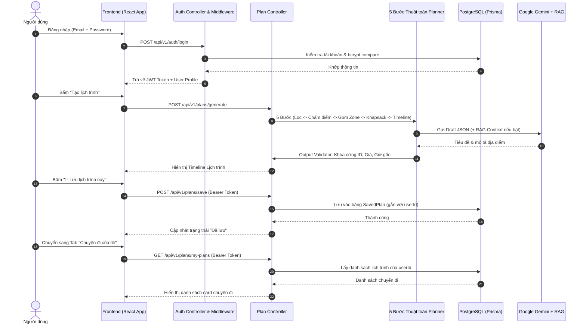

# Sổ Tay Kỹ Thuật: Hướng Dẫn Làm Việc Với Codebase GeoZone AI 📘

Tài liệu này được biên soạn dành cho cả 4 thành viên trong nhóm, giúp mọi người hiểu sâu sắc **dòng chảy dữ liệu (Data Flow)**, **nhiệm vụ của từng file code**, **hệ thống xác thực User/Auth** và **cách lưu trữ & quản lý chuyến đi (Saved Plans)**.

---

## 1. Bản Đồ Dòng Chảy Dữ Liệu (Architecture & Data Flow)

Hệ thống hoạt động theo nguyên tắc: **Backend tính toán logic và tiền bạc $\to$ LLM chỉ hỗ trợ diễn đạt $\to$ RAG bổ sung mẹo bản địa $\to$ Quản lý lưu trữ chuyến đi theo từng User**.



---

## 2. Giải Thích Chi Tiết Nhiệm Vụ Của Từng File Code

### 2.1. Phân Hệ Người Dùng & Xác Thực (User / Auth Module)
- [backend/src/middlewares/authMiddleware.js](file:///c:/Users/Admin/Desktop/GEO_ZONE/backend/src/middlewares/authMiddleware.js):
  - `requireAuth`: Kiểm tra token `Bearer <token>` trong header `Authorization`. Nếu hợp lệ, giải mã JWT và gán user vào `req.user`. Nếu không, trả về lỗi `401 Unauthorized`.
  - `optionalAuth`: Nếu có token thì lấy thông tin user, không có thì vẫn cho đi tiếp.
- [backend/src/controllers/auth.controller.js](file:///c:/Users/Admin/Desktop/GEO_ZONE/backend/src/controllers/auth.controller.js):
  - `register`: Xác thực email, password (tối thiểu 6 ký tự), băm mật khẩu bằng `bcryptjs`, sinh avatar mặc định và phát sinh JWT Token.
  - `login`: Kiểm tra email, so khớp hash mật khẩu bằng `bcrypt.compare`, phát sinh JWT Token.
  - `getMe`: Trả về thông tin profile của `req.user`.
- [backend/src/routes/auth.routes.js](file:///c:/Users/Admin/Desktop/GEO_ZONE/backend/src/routes/auth.routes.js): Cung cấp các endpoint:
  - `POST /api/v1/auth/register`
  - `POST /api/v1/auth/login`
  - `GET /api/v1/auth/me`
- [frontend/src/components/auth/AuthModal.jsx](file:///c:/Users/Admin/Desktop/GEO_ZONE/frontend/src/components/auth/AuthModal.jsx): Hộp thoại Modal đăng nhập / đăng ký trên giao diện, có sẵn nút tiện ích **"Điền tài khoản Demo"** (`demo@geozone.vn` / `password123`) để test nhanh.

---

### 2.2. Phân Hệ Lưu & Quản Lý Lịch Trình (Saved Plans / My Trips)
- [backend/prisma/schema.prisma](file:///c:/Users/Admin/Desktop/GEO_ZONE/backend/prisma/schema.prisma):
  - Bảng `User`: Lưu trữ `id, email, password, name, avatar, role (USER/ADMIN), createdAt`.
  - Bảng `SavedPlan`: Lưu trữ `id, userId, planTitle, city, totalDays, totalBudget, actualCost, strategyUsed, planData (JSON), createdAt`.
- [backend/src/controllers/plan.controller.js](file:///c:/Users/Admin/Desktop/GEO_ZONE/backend/src/controllers/plan.controller.js):
  - `savePlan`: `POST /api/v1/plans/save` — Lưu toàn bộ object JSON lịch trình gắn với `req.user.id`.
  - `getMyPlans`: `GET /api/v1/plans/my-plans` — Lấy danh sách các chuyến đi đã lưu của user hiện tại, sắp xếp theo thời gian mới nhất.
  - `getPlanById`: `GET /api/v1/plans/:id` — Xem lại chi tiết 1 lịch trình cũ (có kiểm tra quyền sở hữu).
  - `deletePlan`: `DELETE /api/v1/plans/:id` — Xóa 1 chuyến đi đã lưu khỏi tài khoản.
- [frontend/src/components/saved/SavePlanModal.jsx](file:///c:/Users/Admin/Desktop/GEO_ZONE/frontend/src/components/saved/SavePlanModal.jsx): Popup cho phép người dùng đặt tên cho chuyến đi trước khi lưu.
- [frontend/src/components/saved/MyTripsView.jsx](file:///c:/Users/Admin/Desktop/GEO_ZONE/frontend/src/components/saved/MyTripsView.jsx): Màn hình "Chuyến đi của tôi" liệt kê các chuyến đi, hỗ trợ bấm **"👁️ Xem chi tiết"** để mở lại lịch trình trên Timeline hoặc **"Xóa"**.

---

### 2.3. Thư mục `backend/src/services/planner/` (Thuật toán cốt lõi)

| File | Nhiệm vụ kỹ thuật | Hàm chính | Khi nào cần sửa file này? |
|---|---|---|---|
| `candidateFilter.js` | Lọc các địa điểm từ DB khớp với thành phố và tags sở thích. Có cơ chế fallback tự bổ sung điểm phổ biến nếu kết quả lọc quá ít. | `filterCandidatePlaces(request)` | Khi muốn thay đổi quy tắc lọc (ví dụ: chỉ lọc địa điểm mở cửa vào ngày đi). |
| `placeScorer.js` | Tính điểm số phù hợp $Score(i) = w_1 \cdot Sở\_thích + w_2 \cdot Phổ\_biến + w_3 \cdot Chi\_phí$. Sắp xếp danh sách điểm theo độ ưu tiên. | `scorePlaces(places, userPreferences, weights)` | Khi muốn tinh chỉnh trọng số $w_1, w_2, w_3$ để ưu tiên tiết kiệm tiền hơn hoặc ưu tiên địa điểm nổi tiếng hơn. |
| `zoneGrouper.js` | Dùng cấu trúc dữ liệu `Map` để gom các địa điểm có cùng `zone_id` lại với nhau, tính điểm trung bình của mỗi Zone. | `groupPlacesByZone(places)` | Khi muốn bổ sung logic kiểm tra vị trí tâm của Zone hoặc lọc Zone không có điểm nào. |
| `dayAllocator.js` | Giải thuật tham lam (Greedy Knapsack): Phân bổ các Zone vào từng ngày sao cho tổng chi phí địa điểm không vượt quá ngân sách ngày ($Budget / Days$). | `allocateDays(zoneMap, totalDays, totalBudget)` | Khi muốn đổi chiến lược ghép Zone (ví dụ: cho phép 1 ngày đi qua 2 Zone lân cận nhau). |
| `timeSlotScheduler.js` | Chia khung giờ trong ngày: 08:00 sáng đến chiều, tự động chèn khoảng nghỉ và cộng thời gian di chuyển 15–30 phút giữa các điểm. | `scheduleTimeSlots(dayBundles, startTime)` | Khi muốn thay đổi thời gian xuất phát buổi sáng hoặc thêm thời gian nghỉ ăn trưa cố định (11:30 - 13:00). |
| `dynamicSwapEngine.js` | Xử lý nút bấm "🔄 Đổi địa điểm": Tìm điểm thay thế *cùng Zone*, *chưa có trong lịch trình*, và *chi phí nhỏ hơn ngân sách còn lại*. | `executeDynamicSwap(request)` | Khi muốn bổ sung tiêu chí hoán đổi (ví dụ: ưu tiên điểm cùng category với điểm bị đổi). |

---

### 2.4. Thư mục `backend/src/services/ai/` (Tầng LLM & RAG)

| File | Nhiệm vụ kỹ thuật |
|---|---|
| `llmClient.js` | Khởi tạo kết nối tới Google GenAI SDK (`@google/genai`) với model `gemini-2.5-flash`. |
| `prompts/systemPrompts.js` | Chứa System Prompt nghiêm ngặt yêu cầu LLM **tuyệt đối không bịa đặt địa điểm, không sửa giá tiền, không sửa giờ giấc**. |
| `prompts/narrativePrompt.js` | Chứa hàm tạo User Prompt cho 2 phương án: Dạng thô (No-RAG) và Dạng kèm ngữ cảnh cẩm nang (RAG). |
| `strategies/directJsonStrategy.js` | Thực thi **Phương án 1 (Không có RAG)**: Đưa JSON trực tiếp vào prompt để LLM sinh narrative. |
| `strategies/ragStrategy.js` | Thực thi **Phương án 2 (Có RAG)**: Gọi `knowledgeRetriever` lấy cẩm nang trước rồi mới yêu cầu LLM sinh cẩm nang du lịch. |
| `rag/vectorStore.js` | Bộ nhớ vector in-memory tính độ tương đồng Cosine Similarity để tìm văn bản cẩm nang liên quan. |
| `rag/knowledgeRetriever.js` | Tìm kiếm mẹo văn hóa, ẩm thực, di chuyển tương ứng với các địa điểm trong lịch trình. |
| `outputValidator.js` | **Lớp phòng thủ dữ liệu:** Nhận chuỗi JSON từ LLM, parse và chỉ lấy tiêu đề + lời văn mô tả; toàn bộ thông tin giá tiền và thời gian luôn lấy lại từ dữ liệu gốc của DB để loại bỏ 100% ảo giác số liệu. |

---

## 3. Hướng Dẫn Cài Đặt & Chạy Thử Hệ Thống

### Bước 1: Khởi động Backend
1. Mở cửa sổ Terminal trong VS Code:
   ```bash
   cd backend
   npm install
   ```
2. Cấu hình file `.env`:
   ```bash
   cp .env.example .env
   ```
   Điền thông số `DATABASE_URL`, `JWT_SECRET`, `GEMINI_API_KEY`.
3. Đồng bộ CSDL và nạp dữ liệu:
   ```bash
   npm run prisma:generate
   npm run prisma:migrate
   npm run db:seed
   ```
   *Lưu ý: Lệnh seed sẽ tự động tạo sẵn 2 tài khoản test:*
   - **Tài khoản Demo:** `demo@geozone.vn` / Mật khẩu: `password123`
   - **Tài khoản Admin:** `admin@geozone.vn` / Mật khẩu: `admin123`
4. Chạy Backend:
   ```bash
   npm run dev
   ```

### Bước 2: Khởi động Frontend
1. Mở Terminal thứ hai:
   ```bash
   cd frontend
   npm install
   npm run dev
   ```
2. Truy cập `http://localhost:3000` trên trình duyệt.

---

## 4. Kịch Bản Kiểm Thử Toàn Diện Tính Năng Mới

1. **Thử nghiệm Đăng ký & Đăng nhập:**
   - Bấm nút **"👤 Đăng nhập / Đăng ký"** góc trên bên phải.
   - Nhấn nút "Điền tài khoản Demo" $\to$ Bấm Đăng nhập $\to$ Header hiển thị avatar, tên người dùng và badge `USER`.
2. **Thử nghiệm Tạo & Lưu Lịch Trình:**
   - Điền Form: 2 ngày Đà Nẵng, 1.500.000đ $\to$ Bấm "Tạo lịch trình tối ưu".
   - Khi timeline hiển thị, bấm nút **"💾 Lưu lịch trình này"**.
   - Nhập tên chuyến đi (hoặc dùng tên mặc định) $\to$ Bấm "Xác nhận lưu" $\to$ Nút chuyển sang trạng thái "✅ Đã lưu vào Chuyến đi".
3. **Thử nghiệm Quản lý Chuyến đi (My Trips):**
   - Bấm vào tab **"🧳 Chuyến đi của tôi"** trên thanh Header.
   - Lịch trình vừa lưu sẽ hiển thị dưới dạng Card với đầy đủ thông tin: Tiêu đề, số ngày, chi phí dự toán vs thực tế, ngày tạo.
   - Bấm **"👁️ Xem chi tiết"** $\to$ Hệ thống tự động chuyển về màn hình Timeline với đầy đủ dữ liệu, bản đồ Zone và cho phép hoán đổi địa điểm.
   - Thử bấm nút **"Xóa"** một chuyến đi $\to$ Hệ thống xác nhận và xóa khỏi CSDL ngay lập tức.
