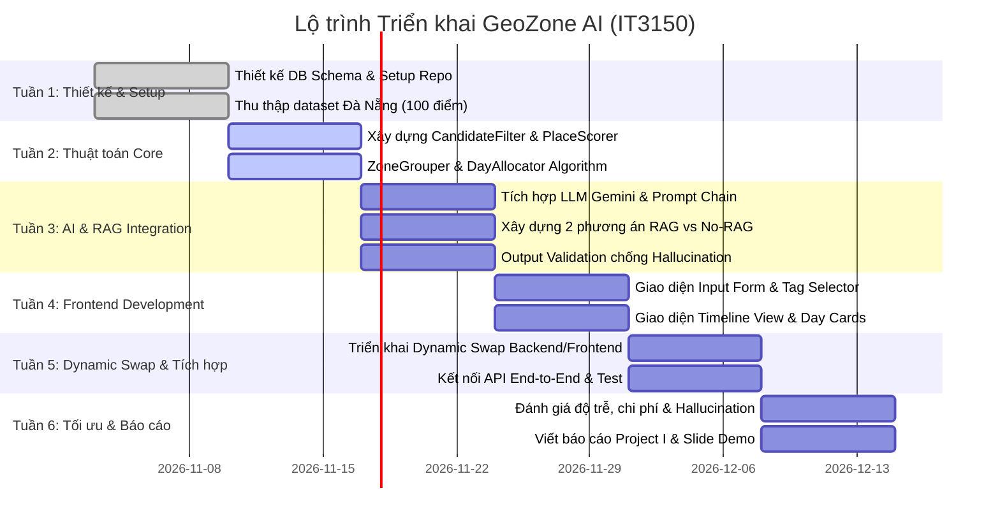

# Kế Hoạch Dự Án Chi Tiết: GeoZone AI (IT3150 - Project I)

## 1. Tổng quan Dự án
- **Tên đề tài:** GeoZone AI – Nền tảng tự động lập lịch trình du lịch cá nhân hóa dựa trên phân vùng địa lý và LLM.
- **Bản chất kỹ thuật:** Hệ thống tối ưu hóa và gom cụm địa lý (Zone-based Clustering & Greedy Knapsack Scheduling) trên Backend, kết hợp Mô hình ngôn ngữ lớn (LLM) để tổng hợp narrative và làm giàu bằng tri thức (RAG).
- **Quy mô thử nghiệm:** Thành phố Đà Nẵng (100–150 địa điểm chuẩn hóa, chia thành 5 Zones).

---

## 2. Phân công Nhiệm vụ (Nhóm 4 Thành viên)

| Thành viên | Vai trò | Trách nhiệm chính | Các file code & thư mục phụ trách |
|---|---|---|---|
| **Thành viên 1** | **Data & Database Lead** | - Thu thập, chuẩn hóa 100-150 địa điểm Đà Nẵng. - Phân bổ tọa độ, gán nhãn `zone_id`, `tags`, chi phí, giờ mở/đóng cửa. - Thiết kế schema PostgreSQL (Prisma), viết script seed database. - Thu thập tài liệu cẩm nang du lịch cho RAG Knowledge Base. | `data/raw/danang_places.json` `data/knowledge_base/*` `data/seed/seed.ts` `backend/prisma/schema.prisma` |
| **Thành viên 2** | **Backend Core & Algorithm Lead** | - Thiết lập Express.js & TypeScript architecture. - Viết các hàm nghiệp vụ: lọc ứng viên (Filter), chấm điểm (Scorer), gom nhóm theo Zone (ZoneGrouper). - Triển khai thuật toán lập lịch trình thỏa mãn ràng buộc ngân sách & thời gian (DayAllocator, TimeSlotScheduler). - Xây dựng tính năng Hoán đổi động (Dynamic Swap Engine). | `backend/src/services/planner/*` `backend/src/controllers/*` `backend/src/routes/*` `backend/src/types/plan.types.ts` |
| **Thành viên 3** | **AI & RAG Engineer** | - Tích hợp Gemini API qua Google Gen AI SDK. - Xây dựng 2 phương án: **Không có RAG** (Direct JSON) và **Có RAG** (Knowledge Retrieval). - Thiết kế System Prompts ràng buộc chống ảo giác (Anti-hallucination). - Xây dựng cơ chế Output Validation & Merging bảo vệ dữ liệu giá/thời gian của DB. | `backend/src/services/ai/*` `backend/src/services/ai/prompts/*` `backend/src/services/ai/strategies/*` `backend/src/services/ai/rag/*` |
| **Thành viên 4** | **Frontend UI/UX Lead** | - Xây dựng giao diện tương tác người dùng bằng React + Vite + Tailwind CSS. - Xây dựng Input Form (ngân sách, số ngày, sở thích, toggle RAG). - Thiết kế Timeline View trực quan hiển thị hoạt động từng ngày. - Triển khai popup Dynamic Swap và bản đồ phân cụm Zone trực quan. | `frontend/src/components/*` `frontend/src/services/api.ts` `frontend/src/App.tsx` `frontend/src/types/index.ts` |

---

## 3. Lộ trình Triển khai (Timeline 6 Tuần)

---

## 4. Bảng Đánh giá Rủi ro & Giải pháp Dự phòng

| Rủi ro kỹ thuật | Mức độ | Giải pháp phòng ngừa của GeoZone |
|---|---|---|
| **LLM tự ý sửa đổi giá tiền / giờ mở cửa** | Cao | Áp dụng cơ chế **Output Validation & Merging**: LLM chỉ sinh mô tả (`aiDescription`), toàn bộ giá tiền và giờ mở cửa luôn được Backend inject từ DB gốc. |
| **Không tìm thấy điểm phù hợp sở thích** | Trung bình | Tích hợp **Fallback Relaxation**: nếu số địa điểm lọc theo tag không đủ số lượng tối thiểu cho các ngày, hệ thống tự động bổ sung các địa điểm phổ biến (`popularity >= 0.8`). |
| **Zone quá xa hoặc không kịp thời gian di chuyển** | Trung bình | Lưu ma trận thời gian di chuyển ước tính `ZoneDistance` và cộng thêm đệm an toàn 15–30 phút giữa các chặng. |
| **Chi phí gọi LLM API hoặc mất mạng** | Thấp | Thiết lập hệ thống fallback template cục bộ, đảm bảo lịch trình vẫn hiển thị ngay cả khi LLM API gặp sự cố. |
