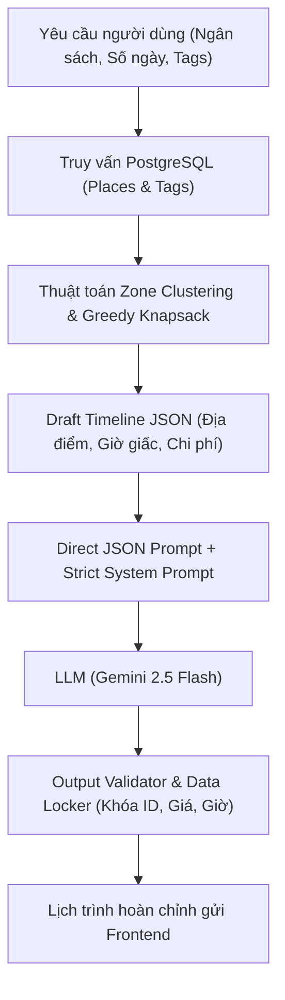
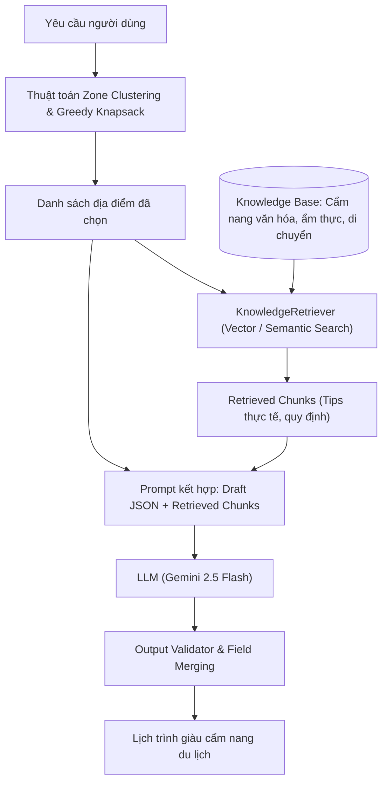

# So sánh Chi tiết: Phương án KHÔNG CÓ RAG vs CÓ RAG trong GeoZone AI

## 1. Đặt Vấn Đề Về RAG Trong Đề Tài Lập Lịch Trình

Trong nhiều đề tài sinh viên, việc **"lấy dữ liệu từ Database rồi đưa vào Prompt của LLM"** hay bị gọi nhầm là RAG. 
- Trên thực tế, quy trình đó đơn thuần là **Database-to-Prompt Injection** (Truy vấn CSDL có cấu trúc kết hợp LLM).
- **RAG (Retrieval-Augmented Generation)** thực sự đòi hỏi: Có một kho tri thức phi cấu trúc (Knowledge Base) hoặc tài liệu bán cấu trúc; thực hiện truy xuất ngữ nghĩa (Semantic Search / Embedding) hoặc truy xuất tài liệu chuyên sâu để làm giàu ngữ cảnh trước khi LLM sinh câu trả lời.

Nhằm giúp đồ án vừa chuẩn mực về mặt học thuật, vừa linh hoạt trong triển khai thực tế, GeoZone AI được thiết kế theo **Design Pattern: Strategy Pattern**, hỗ trợ cả 2 phương án:

---

## 2. Bảng So Sánh Kiến Trúc Hai Phương Án

| Tiêu chí | Phương án 1: KHÔNG CÓ RAG (Direct JSON) | Phương án 2: CÓ RAG (Knowledge Augmented) |
|---|---|---|
| **Nguồn dữ liệu** | Chỉ lấy dữ liệu bảng có cấu trúc từ PostgreSQL (`places`, `zones`, `tags`). | Dữ liệu PostgreSQL + Kho tài liệu tri thức (`danang_food_guide.md`, `culture_rules.md`, cẩm nang bản địa). |
| **Cơ chế Truy xuất** | Thuật toán Backend lọc SQL & Greedy Knapsack chọn danh sách địa điểm. | Sau khi Backend chọn địa điểm, module `KnowledgeRetriever` truy xuất thêm các đoạn văn bản (chunks) cẩm nang liên quan qua Vector / Keyword search. |
| **Nội dung Prompt gửi LLM** | Chỉ có JSON thô các địa điểm (Tên, Zone, Giờ, Chi phí). | JSON thô các địa điểm + Chunks tri thức cẩm nang du lịch thực tế (lưu ý trang phục, món nên ăn, giờ hoàng hôn đẹp). |
| **Đầu ra sinh bởi LLM** | Tiêu đề ngày (`title`) và mô tả ngắn gọn (`aiDescription`). | Tiêu đề ngày + mô tả sinh động + mẹo du lịch thực tế (`aiTravelTip`). |
| **Độ trễ phản hồi (Latency)** | **Rất nhanh (1–2 giây)** do prompt ngắn, không tốn thời gian embedding/vector search. | **Vừa phải (2–4 giây)** do cần bước embedding và mở rộng ngữ cảnh prompt. |
| **Chi phí Token API** | Rất thấp (khoảng 300–600 tokens/lần gọi). | Trung bình (khoảng 1.200–2.000 tokens/lần gọi). |
| **Nguy cơ Hallucination** | Cực thấp (LLM chỉ biên tập lại danh sách có sẵn). | Được kiểm soát chặt chẽ bằng cách khóa cứng các trường ID, Cost, Time từ Backend; chỉ cho phép LLM bổ sung trường `aiTravelTip`. |
| **Trải nghiệm người dùng** | Lịch trình chuẩn xác về giờ và tiền, nhưng lời văn mang tính khuôn mẫu. | Lịch trình sống động, giống như được một hướng dẫn viên bản địa tư vấn tận tình. |

---

## 3. Kiến Trúc Chi Tiết của Phương Án 1 (KHÔNG CÓ RAG)

### Mã nguồn phụ trách:
- `backend/src/services/ai/strategies/directJsonStrategy.ts`
- `backend/src/services/ai/prompts/systemPrompts.ts` (`STRICT_PLANNER_SYSTEM_PROMPT`)

---

## 4. Kiến Trúc Chi Tiết của Phương Án 2 (CÓ RAG)

### Mã nguồn phụ trách:
- `backend/src/services/ai/strategies/ragStrategy.ts`
- `backend/src/services/ai/rag/knowledgeRetriever.ts`
- `backend/src/services/ai/rag/embedder.ts`
- `backend/src/services/ai/rag/vectorStore.ts`
- `data/knowledge_base/*`

---

## 5. Kết Luận & Khuyến Nghị Trình Bày Đồ Án (Project I)

Khi báo cáo với Hội đồng phản biện hoặc Giảng viên hướng dẫn:
1. **Giải thích rõ sự phân biệt:** Nhóm hiểu sâu sắc bản chất kỹ thuật: việc gom nhóm địa điểm và kiểm soát ngân sách là bài toán Tối ưu hóa trên Backend (Data & Planning Layer), còn RAG là công cụ làm giàu tri thức địa phương (AI Knowledge Layer).
2. **Demo trực tiếp Toggle RAG:** Trên giao diện có nút gạt Switch **"Kích hoạt RAG"**.
   - Khi **Tắt RAG**: Nhấn tạo lịch trình, hệ thống phản hồi cực nhanh, lịch trình gọn gàng, ngân sách và thời gian chuẩn 100%.
   - Khi **Bật RAG**: Lịch trình xuất hiện thêm các badge **"💡 Mẹo bản địa"** (Ví dụ: Chùa Linh Ứng nhắc trang phục, Chợ Cồn nhắc mang tiền lẻ và quán ốc hút ngon, Bán đảo Sơn Trà nhắc quy định cấm xe tay ga).
3. Cách tiếp cận này giúp nhóm đạt điểm tối đa ở cả 3 tiêu chí:
   - Tính chặt chẽ của thuật toán (Khắc phục triệt để Hallucination).
   - Kiến trúc phần mềm chuẩn mực (Design Patterns: Strategy, Controller-Service-Repository).
   - Ứng dụng AI đúng bản chất và mang lại giá trị thực tế cao.
